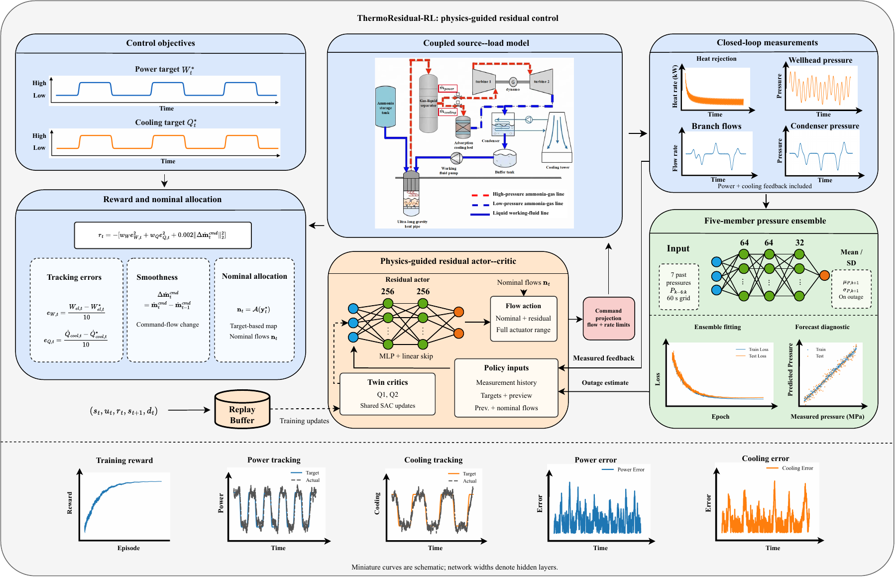

# ThermoResidual-RL

Physics-guided residual reinforcement learning for geothermal power and cooling control under model mismatch.

[中文说明](README.zh-CN.md) · [Computational protocol](docs/PROTOCOL.md) · [Data and units](docs/DATA.md)

This repository contains the final simulator, controller implementations, frozen
configurations and policy assets used for the manuscript. It includes no
development archives, earlier implementations, original field recordings or
private project reports. The license is [MIT](LICENSE).

## Method

ThermoResidual-RL uses a nominal thermodynamic allocation as an explicit action
reference and learns dynamic corrections from causal operating history. Its
action mapping covers the same complete branch-flow range as full-action soft
actor-critic (SAC). Both use the same hard flow and rate projection.

[](docs/figures/control_framework.png)

**Algorithm overview.** Measurements feed the shared history and nominal
allocator; the residual actor provides the command correction. Projected commands
drive the coupled plant, whose measured response supplies the next observation
and reward. The pressure ensemble supports forecasting and missing-measurement
substitution. The small curves in the diagram are schematic, not benchmark data.

The stochastic reference simulator couples formation thermal storage, ammonia
inventory and internal energy, hydraulic delivery, power production, adsorption
cooling, condenser heat rejection and liquid return. Process disturbances change
model parameters; pressure and heat remain consequences of the physical states
and commands. Six controllers are implemented:

| CLI name | Controller |
|---|---|
| `rrl` | ThermoResidual-RL |
| `sac` | Information-aligned full-action SAC |
| `pi` | Nominal allocation plus proportional-integral feedback |
| `gspid` | Gain-scheduled proportional-integral-derivative control |
| `mpc` | Constrained model predictive control |
| `physics` | Nominal thermodynamic allocation |

## Installation

Python 3.11 is the tested interpreter. Create a clean environment and install:

```bash
python -m venv .venv
source .venv/bin/activate
python -m pip install -r requirements-dev.txt
python reproduce.py --verify-only
python -m pytest -q
```

On Windows use `.venv\Scripts\activate`. The pinned packages are the tested
versions. CPU evaluation is supported; CUDA training needs a PyTorch installation
compatible with the local NVIDIA driver. The physical solver runs on CPU even
when neural updates use a GPU. Tests do not require field data or a GPU.

## Quick Start

Run a short common-seed comparison of all six frozen controllers:

```bash
python reproduce.py --suite demo --workers 2 --output outputs/demo
python plot_results.py --input outputs/demo/demo_256 --output outputs/demo/figures
python summarize_results.py --input outputs/demo/demo_256/metrics.csv --output outputs/demo/summary.csv
```

The demo has 256 steps and a 200-step warmup, so it is a software check rather
than the manuscript's 3,200-step performance evaluation. Results, pointwise CSV
files and failure records are written under the requested output directory.
Existing outputs are checked against their job and trace hashes before reuse.

## Frozen Evaluation

```bash
python reproduce.py --suite main --workers 4 --output outputs/evaluation
python reproduce.py --suite stress --workers 4 --output outputs/evaluation
python reproduce.py --suite weights --workers 4 --output outputs/evaluation
```

| Suite | Trajectories | Purpose |
|---|---:|---|
| `main` | 480 | Six controllers, four target families, four conditions, five process realizations |
| `stress` | 840 | Five controllers across reference and six plant interventions |
| `weights` | 320 | Four additional RRL/SAC policies at two tracking-weight ratios |
| `sensor` | 792 | Pressure-interface diagnostics at 60 s acquisition and 10 s control |

Use `--controllers`, `--profile`, `--condition` and `--limit` to select a subset.
The `sensor` suite is separate from the normal 10 s acquisition protocol and
can be run with `python reproduce.py --suite sensor --workers 4`. It includes
all current absolute-pressure diagnostic cases, not a claim of invariance to
sampling-cadence changes. All trajectories are simulated. Process realizations
describe fixed-policy disturbance variation, not independent policy training.

## Training and Baseline Tuning

The paired learning recipe uses two 256-unit layers, common normalization,
identical initial network tensors, empty replay, shared SAC hyperparameters and
768,000 interactions per run. Checkpoints are selected by common cost on the
frozen development windows. Final evaluation does not select checkpoints.

```bash
# Short execution checks, not full-budget results
python train.py --controller rrl --device cpu --smoke --output outputs/rrl_smoke
python train.py --controller sac --device cpu --smoke --output outputs/sac_smoke
python tune_baselines.py --controller pi --smoke --output outputs/pi_smoke

# Full runs: launch these in separate terminals for two-GPU training
python train.py --controller rrl --device cuda:0 --output outputs/rrl
python train.py --controller sac --device cuda:1 --output outputs/sac

# Current weight-sensitivity recipe; also accepts --weight-ratio 2
python train.py --controller rrl --weight-ratio 0.5 --device cuda:0 --output outputs/rrl_weight_0p5

# Development-only baseline search; gains are frozen for final evaluation
python tune_baselines.py --controller pi --output outputs/tune_pi
python tune_baselines.py --controller mpc --output outputs/tune_mpc
python tune_baselines.py --controller gspid --output outputs/tune_gspid
```

Training needs a new output directory and starts from the distributed empty
learner state, not from the selected trained policy. Baseline grids contain
24 PI, nine MPC and 54 GS-PID configurations. See [the protocol](docs/PROTOCOL.md)
for the observation, action composition, cost and checkpoint rules.

## Files

```text
thermoresidual/       Final physics, control, learning and evaluation code
assets/model/        Frozen physical/process coefficients and integration settings
assets/policies/     Main policies and current weight-sensitivity policies
assets/pressure/     Five-member causal pressure predictor
configs/             Frozen evaluation jobs
data/synthetic/      Explicitly labelled simulated example and units
docs/                Protocol, reproducibility guide and one algorithm figure
tests/               Numerical, interface, asset and privacy checks
tools/               Release audit
```

## Data and Reproducibility

Only a simulated example is bundled. Generate another with:

```bash
python generate_synthetic_data.py --output outputs/synthetic
python tools/audit_public_release.py
```

Raw field CSV/Excel files, measurement logs, project reports, account information
and replay buffers are excluded. Trained weights and effective coefficients are
derived model assets. The supplied pressure network can be used for inference;
reproducing its original fit requires separately authorized records, which this
repository does not distribute. See [DATA.md](docs/DATA.md) for the inventory
and [REPRODUCIBILITY.md](docs/REPRODUCIBILITY.md) for checks and output handling.

For citation metadata see [CITATION.cff](CITATION.cff). Software dependencies
retain their own licenses, summarized in [THIRD_PARTY_NOTICES.md](THIRD_PARTY_NOTICES.md).
